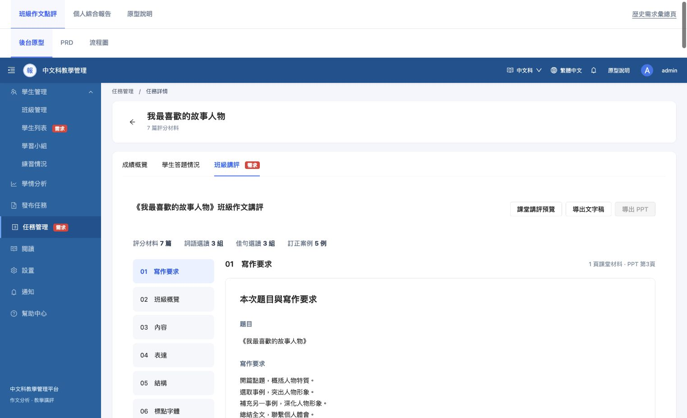
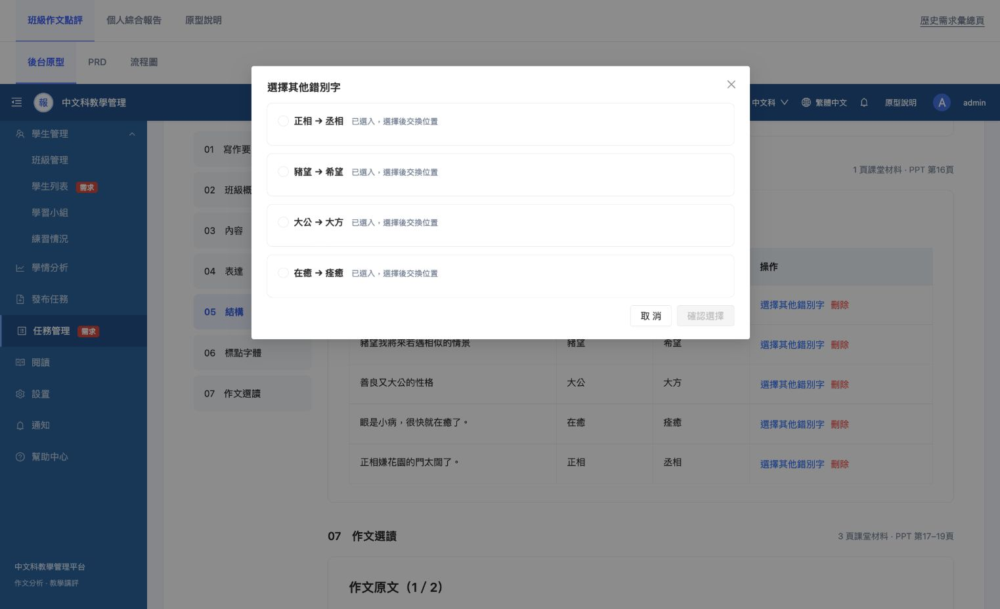
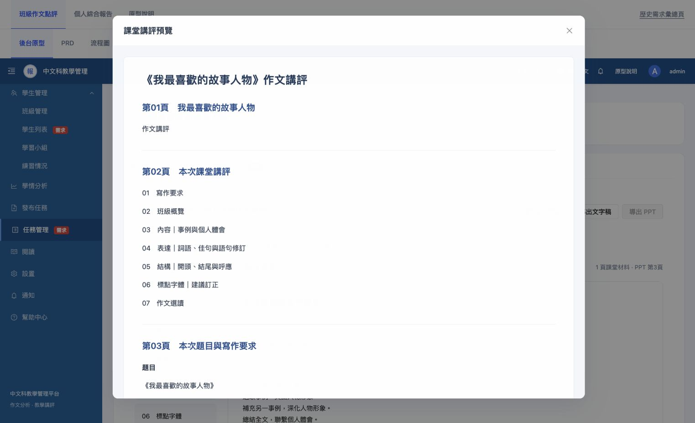
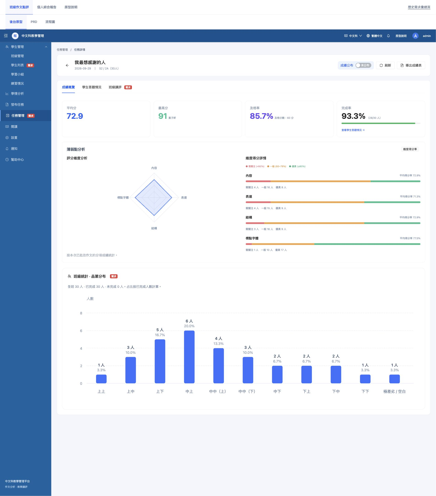
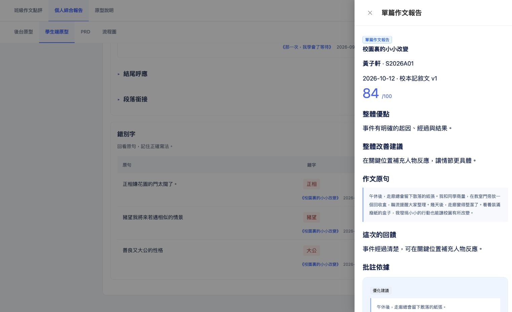

# 班级作文讲评与个人综合报告：需求与规范走查

日期：2026-10-13。状态：走查记录，待产品评审及验收。本文不替换已确认需求，不代表正式后台已接入。

## 1. 结论与范围

七章讲评、原文与已有评价成组展示、订正选择、预览已能演示。主要不足是需求正文与迭代附录冲突、不同页面数据不一致、调整后的材料无法同步导出PPT，以及个人报告原文定位未完成。多数工作是确定性规则、数据契约和界面状态处理，不需要新增AI。

本次读取班级/个人PRD、正式生成规则、系统规则审查、待确认事项、相关源码及共用设计规范；实际操作当前本地讲评、订正选择、预览、成绩概览、学生端原报告入口。没有修改业务代码或选材结果，没有改变验收状态，没有发布。

证据分为：当前界面实测、源码可确定的边界缺陷、已批准的演示限制、待补充需求。不能用演示缺口推断正式系统没有源数据。

## 2. 实际走查步骤

|步骤|内容|健康度及结论|
|---|---|---|
|01|班级讲评与七章阅读|基本可用；目录和原文/评语可读。PPT当前禁用，原因未常驻可见。|
|02|订正候选选择|部分可用；打开后四个候选都已选入，操作实际为交换位置，没有更多后台候选。取消退出，未修改选择。|
|03|课堂讲评预览|基本可用；标题、章节、正文层级清楚。长稿仍为连续滚动，没有章节快捷定位。|
|04|成绩概览|演示可用；28/30完成率与品第30/30同时存在，属于已批准的不同模拟来源，正式联动未完成。|
|05|学生端订正来源|待补齐；进入摘要抽屉，没有定位对应订正，也不是PRD要求的完整报告。|

### 01 班级讲评

### 02 订正候选

### 03 课堂预览

### 04 成绩概览

### 05 学生端来源

## 3. 应优先处理的问题

P0指正式接入前必须闭合；P1指本轮需求/原型应完善；P2指体验优化。优先级为本次建议，不等于新增已确认范围。

|编号/优先级|证据与不足|建议及可测验收|
|---|---|---|
|A01 · P1|班级PRD主文仍写PPT待接入禁用、来源抽屉/更新/保存入口；后续附录又改为来源PPT下载及仅3按钮。个人PRD写无评语汇整，当前却已有可提升与错别字。待确认文件仍保留范文库、PDF旧方向。|将最新确认合入主文，历史移至归档。现行页面、规则、接口、验收条目只保留一个有效口径；过期待确认项移除。依据共用《PRD编写规范》“只展示最终结果”。|
|A02 · P0|步骤01/04：同一路由任务t1，成绩页《我最想感謝的人》28份有效成绩；讲评页《我最喜歡的故事人物》7篇。品第按用户授权截图模拟30人。|正式接入统一class_id、task_id、最终提交集合、评分标准和snapshot_id；老师切Tab不换任务。模拟状态保留在PRD，不重新加回已要求删除的业务说明。验收：同任务题目/学生集合一致，不把7篇、28篇和30人混算。|
|A03 · P0|步骤01/03及PptClassReview.vue：预览/MD使用当前选择；PPT是固定原文件，修改排序也禁用。PRD注明原文件仍有历史待确认文案。|统一内容清单驱动预览、MD、PPT。确认、替换、删除后各输出的条目/顺序/状态一致；无生成能力时不得把旧文件作为最新稿。导出失败保留选择并可重试。|
|A04 · P1|步骤02：候选池只有5项，“选择其他”展示其余已选项，选中会交换。没有新增候选；删除无撤销/恢复默认。|从同任务允许展示的完整纠错池取候选。未选候选优先；无候选明确显示空态；换位与替换分开。删除只影响课堂材料，提供短时撤销或恢复默认。不为凑满5例调用AI。|
|A05 · P1|源码PptClassReview.vue：保存key仅依赖PPT哈希，未含老师/班级/任务；读取失败静默恢复默认。|本机状态至少按用户、班级、任务、源版本隔离；正式稿在后台保存版本。源报告更新后提示选材过期，由老师决定刷新；不能无声覆盖。验收两任务、两账号、跨版本互不串材料。|
|A06 · P1|源码TaskOverview.vue：某维度无有效值返回null，模板直接toFixed；各维度条形占比却用总分有效数作分母。|缺维度显示“—”，有效0保留；维度占比使用该维度有效人数。测试有总分但一个维度全部缺失、部分缺失、有效0三类。此为源码确认的触发缺陷，未向当前界面注入异常数据。|
|A07 · P0|步骤05及TabletReport.vue/PersonalFindings.vue：订正来源只传作文对象；学生端丢失批注定位参数，打开摘要抽屉，未达到P-FR06完整报告要求。|传report_id、text_version、annotation/correction_id、定位范围；进入对应完整报告并高亮。返回恢复周期、展开组及滚动位置。学生查看与教师编辑权限分开。|
|A08 · P1|步骤05及overviewScenarios.js：人物作文的“正相”等示例被附到《校園裏的小小改變》，代码还拼接进演示全文。|更换为来源一致的整套模拟报告，或使用对应原作文的材料。不要将别篇案例追加到全文来制造关联。验收题目、全文、批注、纠错位置一致；源句在指定版本指定范围中逐字匹配。|
|A09 · P0|个人PRD已列公布权限待接入，当前无法由本地演示证明。成绩页显示未公布时，学生演示仍有该题成绩。|正式服务端统一过滤权限：未公布成绩不能通过曲线、均分、问题次数、订正及直链间接暴露。角色/班级归属/公布撤回列入联调测试。当前现象仅证明原型不联动，不代表线上泄露。|

## 4. 原有规则中需要补足的细节

|事项|目前已有依据|还需补充的执行细节|
|---|---|---|
|品第换算|共用《PRD编写规范》第5节已有作文示例：总分÷10四舍五入，0—10整数，并列出52→5→中中（下）等。当前图按截图模拟已获确认。|正式接入优先读取后台品第；如需换算，核对原作文模块现行量表版本与完整映射，不另造区间。明确缺品第人数、分母和“极差劣/空白”中的空白是否实际已评。不能把未提交当最低品第。|
|完成/评分状态|已有提交、批改、公布等对象；缺失不补0已确认。|明确“已提交”“已批改”“有有效成绩”“已公布”各自人数与分母。TaskOverview当前用有总分人数显示完成率，是否沿用原系统状态定义应对齐。|
|固定分类|已有标签优先、固定短语、类别优先级、无法确定则人工核对。|补正反例测试：否定评价、引用他人评价、多标签冲突、同义繁简写法；字典版本和重新统计时机。不能因包含“比喻”就认定优点。|
|原文关联|用户已明确数据存在；正式规则要求版本与范围，不推断缺失关联。|约定UTF-16或Unicode码点、start,end)边界、换行与图片坐标；简繁归一只用于匹配副本，不修改展示原文。两处相同句必须按记录位置定位。|
|频次与案例|共通方向同学生同类去重；至少2人；案例前10名不足继续向后补。|同一标签的展示实例必须与其统计依据相符；无法配对时顺延或显示实际数量。当前第三方向“不同事例各有侧重”配“增加事例”建议，需回查固定标签证据，不能仅凭当前文本断言已通过分类。|
|个人问题计次|个人界面说明同篇不同原句可分别计次；班级按人数去重。|两套口径独立命名；以稳定问题ID/位置区分同文不同处，不能仅按quote/text合并；明确同篇多稿去重和教师改批注后更新。|
|末端老师检核|已经确认：老师在最后自主检核，不设前置人工关卡。|区分人工判断与机器安全处理。系统仍应对空值、越界、过期版本作确定处理，展示缺项，不截错原文或崩溃；这不需要增加前置审批步骤。|
|教师调整范围|已允许删除/选择订正；其他材料替换在生产待实现。|逐项列出可替换、可删、可排序、可编辑的范围；编辑建议应另存教师补充，不覆写已有原评价。不能笼统写“预览与调整”却未定义动作。|
|候选不足/重复|全班不足展示实际数量；同人同类别首轮1组已有规则。|空类别是否隐藏页面、目录如何重编号、0条订正能否导出、重叠原文如何选优，以及老师主动删至不足后的展示。保留“不用AI凑数”。|
|导出与快照|正式规则已要求统一清单与分页校验。|新增异步加载、失败、重试、重复点击、源数据更新、超长段落和超宽表格；页码动态计算，正文不因分页被截断，原文可重组。MD表格中的竖线、换行与Markdown符号需转义。|
|课堂匿名|来源保留与页面来源入口简化均已明确。|确定课堂稿/PPT学生姓名是否匿名、教师审核稿是否显示姓名；删除页面来源弹窗不等于删除内部追溯字段。导出文件不泄露无关账号信息。|

## 5. 设计规范与交互优化

1. **禁用原因可访问（步骤01）**：PPT禁用目前主要靠悬浮提示。补充键盘/触控可读取的原因；不恢复大量原型说明。后台按钮32px、重要按钮40px、触控命中44px的建议分端落实。
2. **学生端来源链接触控区（步骤05）**：PersonalFindings源链接12px、padding为0；按iPad规范文字按钮命中区44px建议扩大点击区，文字可保持紧凑。需真机或视口测量验收。
3. **长稿导航（步骤03）**：预览增加轻量章节定位；打开时定位当前章是否需要保持，与老师课堂使用场景确认。正文样式目前清楚，不需整体重做。
4. **目录与固定栏（步骤01/02）**：偏移量使用硬编码200/208/224，顶部栏高度改变时有错位风险。订正截图出现正文06而目录05高亮，应在顶部栏、浏览器缩放及短视口下复核；当前不把单张状态扩大为所有场景稳定复现。改为依据实际固定栏高度定位。
5. **组件统一**：预览弹窗12px圆角、18px标题与其他后台弹窗需核对共用规范和截图例外；主色、按钮禁用/焦点/加载状态由共用组件统一，减少每页覆盖。

截图和源码只能发现可见风险；本次未完成读屏、全键盘路径、200%缩放、iPad真机、对比度计算和所有异常场景测试，不能据此宣称无障碍合规。

## 6. AI边界

上述数据关联、统计、去重、排序补选、候选替换、状态流转、排版、导出与权限均可由系统规则完成，不必增加AI调用。

当前4条语义订正示例已按用户确认用于原型；这只改变审核状态，不改变它们曾由语义推算产生的来源。不能将“默认确认”推广为生产中所有AI建议自动确认。

将来确有需要时，AI仅作为默认关闭的候选功能：固定分类无法覆盖时返回白名单标签候选；明确授权时返回最小订正建议。必须保留source_kind、source_ids、text_version、rule/model/prompt_version、review_status、reviewer及时间；ID从系统候选集中选择，禁止编造原文、批注、分数、理由来源或自报已确认；允许abstain。非法结构、越界、过期返回确定错误；失败不影响既有规则生成。教师确认后再进入允许展示清单。

## 7. 建议实施顺序与验收矩阵

先合并现行PRD与过期待确认项；再修复缺分异常、来源错配/定位和选择交互；正式接入统一数据快照及权限；最后实现统一PPT导出并做跨端回归。建议责任角色：产品负责范围口径，教研负责分类与品第对应，前后端负责实现，测试负责边界验收；人员及排期待定。

|测试输入/操作|预期|
|---|---|
|0篇、1篇、全班有分但无某维度|无虚构统计，无空值异常；1篇不输出变化结论|
|有效0、缺分、超满分、不同量表|0不丢弃；缺失不补0；异常明确；不同量表不混算|
|同篇多稿、教师改分/批注、源版本更新|只按最终有效版本计数；旧选材标记需更新；快照不混版本|
|材料不足、同句多处、跨章重复、否定批注|顺延到全班后用实际数量；位置准确；按规则去重；不误分类|
|删除、替换、取消、刷新、切任务/账号|取消不变；有恢复路径；选材不串任务；重新进入恢复相应版本|
|文字稿与PPT、长段落/表格/特殊符号|使用同清单同顺序；内容不丢、无截断、表格结构正确|
|未公布、撤回公布、无权限直链|两端聚合及来源报告都遵守同一可见性策略|
|1024宽、短视口、键盘、触控|目录不遮正文；焦点可见；来源可点；禁用原因可获知|

## 8. 主要文件依据

- [班级讲评PRD（源码项目内：`需求02-班级作文讲评-PRD-v0.2.md`）
- 个人综合报告PRD（源码项目内：`需求01-个人跨篇作文分析-PRD-v0.2.md`）
- 正式规则与模板（源码项目内：`sources/10_班级作文讲评_生成规则与内容模板_正式版.md`）
- 规则审查及AI规范（源码项目内：`sources/11_系统生成规则审查与AI输出规范.md`）
- 原待确认事项（源码项目内：`两项需求-待确认事项.md`）
- 课堂材料及导出实现（源码项目内：`../src/components/PptClassReview.vue`）
- 成绩概览实现（源码项目内：`../src/components/TaskOverview.vue`）
- 个人材料实现（源码项目内：`../src/components/PersonalFindings.vue`）
- 学生端报告入口（源码项目内：`../src/components/TabletReport.vue`）
- 个人演示数据（源码项目内：`../src/overviewScenarios.js`）
- 共用规范：原型汇总目录中的《PRD编写规范》《三端设计规范-20261009/03-后台共用设计规范》《01-啟答中文科iPad设计规范》。
