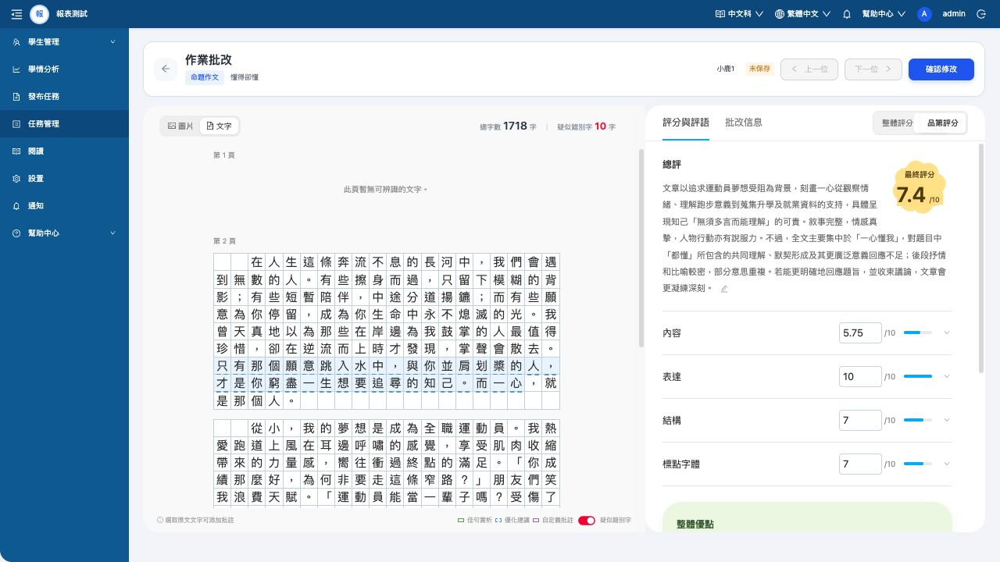
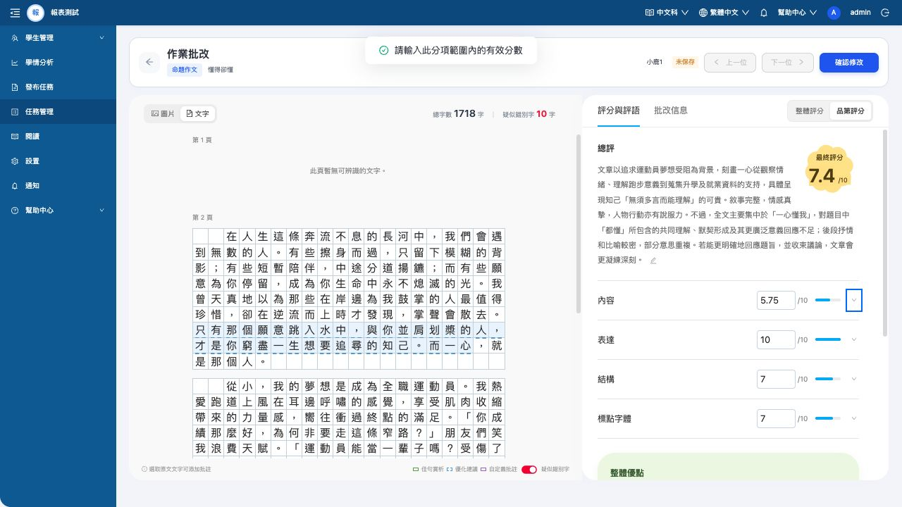

# 作文品第切換需求走查

日期：2026-10-09。方法：当前代码检查＋独立浏览器标签实测。未改动原型代码，未保存测试分数，未覆盖用户原页草稿。原页已有36、30、14、7，总分87；这不是计算错误，示例数据已被编辑并保存。

## 需求清单

| 事项 | 来源/性质 | 当前结果 | 处理建议 |
|---|---|---|---|
| Vue + Ant Design Vue，单页，兼容原风格 | 用户明确要求 | 已实现 | 保持 |
| 整體評分／品第評分切换 | 用户明确要求 | 已实现 | 保持 |
| 权重4:3:2:1、双向改分 | 用户案例及讨论 | 已实现，23/40↔5.75/10实测往返无取整 | 使用同一草稿 |
| 5、6、5、4对应52分 | 用户明确案例 | 默认数据已实现；当前已有保存的87分覆盖默认值 | 不能把已保存编辑误判为样例失效 |
| 4中下、5中中（下）、6中中（上） | 用户截图 | 已实现这三项映射 | 其他区间需教研定义 |
| 页签及分制切换保留修改 | 数据一致性 | 已实现 | 与离开页面分开处理 |
| 顶部始终百分制、标题綜合總分 | 后续讨论建议，未明确最终拍板 | 未实现；仍显示7.4/10，图案上仍为最終評分 | 若采纳，固定百分制并替换素材文字 |
| 原分数＋未保存；保存后修改记录 | 后续讨论建议 | 只有页面顶部未保存标记，无原分和修改历史 | 保存前基线快照，按差异计算状态 |
| 暫無對應品第 | 后续讨论建议 | 未实现，名称直接隐藏 | 区分未评分与有分无对应品第 |
| 空值和0分区分 | 编辑完整性 | 空值被拒绝并恢复旧分，无法呈现待评分 | 建立null状态，未完成不呈现完整总分 |
| 未保存离开提醒 | 编辑安全 | 缺失；刷新直接恢复旧分 | 离开保护或草稿恢复 |
| 小数精度与步长 | 待定规则 | 允许小数；总分十分制仅显示1位；百分制步长4/3/2/1 | 明确展示精度与按钮步长，不对真实分数取整 |
| 确认保存 | 原型能力 | 代码为本机localStorage，无后端 | 正式版需按报告ID隔离并处理失败/并发 |

## 走查步骤与证据

1. 正常：进入已有报告。分项36/40、30/30、14/20、7/10，总分87/100。

2. 部分正常：内容改23，百分制总分74；切十分制为5.75、10、7、7，总分7.4/10。名称均隐藏；没有原分数87的对比。切批改信息再返回，草稿仍在；切回百分制内容仍为23。

3. 待修正：清空内容输入后离焦，恢复5.75而不是空值。提示为绿色成功图标搭配错误文案，语义不一致。没有未评分与待完成总分状态。

4. 有数据丢失风险：刷新测试标签，无离开确认，未保存的23被恢复为已保存36；总分重新为87。

## 优先级

P1：刷新未保存丢失；空值/未完成评分状态。

P2：未匹配品第提示；小数精度与步长规则；错误提示使用绿色成功图标。

建议待确认后实施：顶部固定百分制与改名、原分对比与修改记录。这些是本次讨论建议尚未落地，不当作之前已确认功能的实现错误。

## 代码补充风险

- 分数变动后总评、维度评语仍为固定演示内容；若要做自动评语联动，需要独立需求，不能用分数自动伪造评价。
- dirty只在编辑时设为true，改回原值也保持未保存，未比较已保存基线。
- 保存读取无数组长度、类型校验；本机异常数据可能影响计算。保存分数和总评为两次写入，不是后端事务。
- 黄色标题来自截图素材，DOM中的small被隐藏；修改DOM文字不能改变可见标题，也导致该标题缺少可访问文本。
- 字段有可访问名称，但微调按钮为英文Increase Value/Decrease Value；需补繁体文案。没有进行完整屏幕阅读器与键盘可访问性认证。
- 当前仅一个模拟报告，本机固定key不能直接用于多学生正式数据。侧栏、前后学生停用属明确单页范围，不列为缺陷。

## 建议下一步

先收口评分显示、空值、小数与品第映射规则，再集中修正编辑闭环。原有design-qa通过结论仅代表当时视觉和指定样例验收，不等于这次完整编辑需求验收通过。
